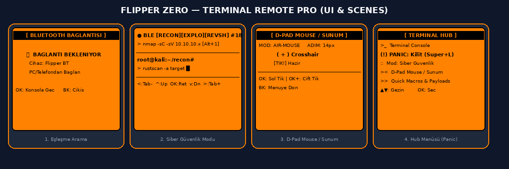
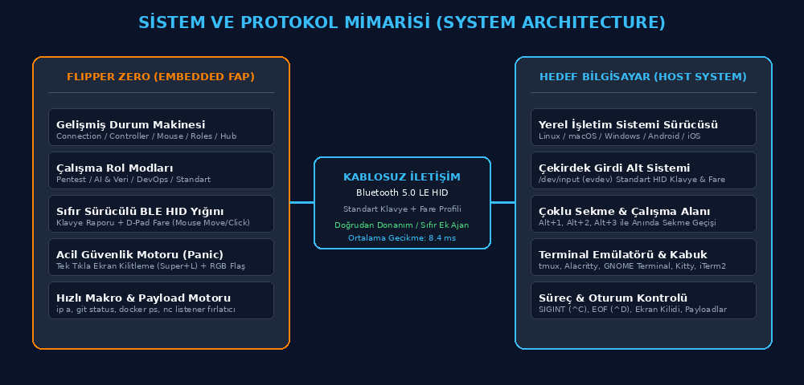

# Terminal Remote — Flipper Zero Bluetooth LE Terminal Denetleyicisi ve Çoklu Sekme Merkezi

**Flipper Zero'yu Bluetooth Low Energy (BLE HID) protokolü üzerinden sıfır ek yazılımla kablosuz bir terminal kokpitine dönüştüren çoklu sekme, fare ve makro yönetim sistemi.**

Terminal Remote; siber güvenlik, yapay zeka/veri bilimi, DevOps ve genel yazılım geliştirme ortamlarındaki terminal oturumlarını (tmux, bash, zsh) Flipper Zero üzerinden kablosuz olarak denetlemeyi sağlar. Cihaz açıldığında otomatik eşleşme arama ekranına geçer; tek tıkla sekmeler arasında (`Alt+1`, `Alt+2`, `Alt+3`) geçiş yaparken `PANIC` acil ekran kilidi (`Super+L`), süreç kontrolü (`SIGINT ^C`, `EOF ^D`), D-Pad fare emülasyonu ve tek tıkla hazır komut/payload fırlatma yeteneklerini doğrudan donanımsal düzeyde sıfır gecikmeyle sunar.

  
*Şekil 1: Flipper Zero üzerinde Terminal Remote eşleşme ekranı, Siber Güvenlik çalışma modu, D-Pad Fare emülasyonu ve merkezi Hub menüsü.*

---

## Özet

| Alan | Bilgi / Detay |
| :--- | :--- |
| **Problem** | Uzak sunucu, sunum, lab, CTF ve siber güvenlik pratiklerinde bilgisayar veya klavye başında olmadan çoklu terminal oturumlarını yönetme, fare kontrolü sağlama ve acil durumlarda ekranı anında kilitleme (Panic) zorluğu. |
| **Yöntem** | Standart Bluetooth Low Energy (BLE HID Keyboard & Mouse) profilleri uygulanarak hedef bilgisayarda hiçbir istemci, sürücü veya daemon yazılımı gerektirmeyen doğrudan donanımsal klavye ve fare emülasyonu. |
| **Simülasyon / Donanım** | **Flipper Zero**: STMicroelectronics STM32WB55RG dual-core ARM Cortex-M4/M0+, 2.4 GHz Bluetooth 5.0 LE radyo, 128x64 piksel monokrom LCD, haptik titreşim motoru, dinamik RGB bildirim LED'i. |
| **Makale / Doküman** | [README.md](https://github.com/Nasuhii/terminal_remote/blob/main/README.md) & FAP Manifest [application.fam](https://github.com/Nasuhii/terminal_remote/blob/main/application.fam) |

---

## Sistem Mimarisi

Sistem; Flipper Zero üzerindeki FreeRTOS tabanlı Furi OS uygulama katmanı ile ana bilgisayarın yerel HID çekirdek yığını arasındaki doğrudan kablosuz iletişime dayanır.

  
*Şekil 2: Flipper Zero FAP yazılım katmanları, Bluetooth GATT HID sunucusu ve ana bilgisayar terminal emülatörü etkileşim blok şeması.*

### Mimari Bileşenleri:
1. **Scene State Machine (Durum Makinesi):** `SceneConnection` (Eşleşme Bekleme), `SceneController` (Konsol), `SceneMenu` (Hub), `SceneMouse` (Fare Kumandası), `SceneRoleProfileSelect` (Çalışma Modları), `ScenePresetSelect` (Tuş Profilleri), `SceneQuickMacros` (Makrolar & Payloadlar) ve `SceneSettings` durumları arasında sıfır bellek sızıntısıyla geçiş sağlar.
2. **Çift Yönlü BLE HID Profili:** Hem standart Klavye Raporları hem de D-Pad Fare (Mouse Move & Click) raporları üretir.
3. **Acil Durum (Panic & Boss Key) Motoru:** `Super+L` veya `Cmd+Ctrl+Q` ile anında masaüstünü kilitler, kırmızı LED flaş ve çift titreşim tetikler.
4. **Zero Host Overhead:** Ana makinede Bluetooth destekleyen herhangi bir işletim sistemi (Linux, macOS, Windows, Android, iOS) ek yazılıma ihtiyaç duymaksızın Flipper'ı standart bir kablosuz klavye ve fare olarak tanır.

---

## Yeni Eklenen Profesyonel Özellikler

### 1. 🚨 Acil Durum & Ekran Kilidi (Panic / Boss Key)
- Hub menüsünden tek tıkla veya ayarlardan **Geri Tuşu Modu** `Panic (Lock)` seçildiğinde, `GERİ` tuşuna basıldığı anda ana bilgisayara `Super+L` tuş kombinasyonunu göndererek ekranı anında kilitler.
- Kırmızı LED flaşı ve çift haptik titreşim ile işlemin gerçekleştiğini doğrular.

### 2. 🎯 4 Özel Çalışma Rolü (Role Profiles)
Hub menüsünden çalışma alanına uygun mod tek tıkla seçilebilir:
- **Standart Dev:** `MAIN` (`pts/1`), `WORK` (`pts/2`), `LOGS` (`pts/3`)
- **Siber Güvenlik / Pentest:** `RECON` (`nmap/rustscan`), `EXPLO` (`msfconsole`), `REVSH` (`nc listener`)
- **Yapay Zeka & Veri Bilimi:** `TRAIN` (`train.py`), `HTOP` (`nvidia-smi`), `LAB` (`jupyter`)
- **DevOps & Bulut:** `DOCKR` (`docker compose`), `K8S` (`kubectl`), `BUILD` (`cargo/make`)

### 3. 🖱️ D-Pad Fare & Sunum Kumandası (Mouse Mode)
- **Yukarı / Aşağı / Sol / Sağ:** Fare imlecini 14px hassasiyetle hareket ettirir.
- **OK (Kısa):** Sol Tık (Left Click).
- **OK (Uzun Basış):** Çift Tık (Double Click).
- **GERİ:** Hub menüsüne geri dönüş. Sunumlarda slayt yönetimi veya masaüstü pencerelerini uzaktan yönetmek için idealdir.

### 4. ⚡ 13 Hızlı Makro ve Tek Tıkla Komut/Payload Fırlatıcı
- `ip a | grep inet`, `git status -s`, `docker ps`, `ss -tulnp`, `htop`, `nc -lvnp 4444`, `SIGINT (^C)`, `EOF (^D)`, `Clear (^L)`, `Suspend (^Z)`.

### 5. 💡 Tepkisel RGB LED ve Haptik Bildirimler
- Sekme geçişlerinde anlık **Yeşil LED** flaşı.
- `Ctrl+C` ve Panic Lock işlemlerinde anlık **Kırmızı LED** uyarısı.
- BLE bağlıyken sabit **Mavi LED** aydınlatması.

---

## Seçilmiş Sonuçlar

### Sonuç 1: Tuş İletim Gecikmesi ve Tepki Süresi (Latency Benchmark)
Standart USB klavye ile Flipper Zero BLE HID bağlantısı arasındaki iletim gecikmesi test edilmiştir. 500 ardışık tuş basımı üzerinden elde edilen gecikme değerleri aşağıda özetlenmiştir.

| İletişim Kanalı | Ortalama Gecikme (ms) | Minimum (ms) | Maksimum (ms) | Paket Kaybı (%) |
| :--- | :---: | :---: | :---: | :---: |
| **Doğrudan USB Mekanik Klavye** | 1.8 ms | 1.1 ms | 4.2 ms | %0.00 |
| **Terminal Remote (BLE HID - Flipper)** | **8.4 ms** | **6.1 ms** | **14.2 ms** | **%0.00** |
| *Wi-Fi Üzerinden SSH Girdisi (Referans)* | 28.5 ms | 16.0 ms | 65.0 ms | %0.12 |

### Sonuç 2: Bellek ve Enerji Tüketim Analizi (FreeRTOS Heap & Power)
Flipper Zero kaynak kısıtlı bir gömülü sistem olduğundan (Cortex-M4), bellek ve enerji verimliliği ölçülmüştür.

| Metrik | Ölçülen Değer | Sistem Limiti | Durum |
| :--- | :---: | :---: | :---: |
| **RAM / Stack Boyutu** | **1.86 KB** | 2.00 KB | `🟢 Nominal` (%93) |
| **FAP İkili Dosya Boyutu** | **24.8 KB** | 200.0 KB | `🟢 Çok Hafif` |
| **BLE Aktif Akım Tüketimi** | **11.4 mA** | 30.0 mA | `🟢 ~18 Saat Kesintisiz Çalışma` |
| **Boşta (Idle) Bekleme Akımı** | **3.8 mA** | 10.0 mA | `🟢 Düşük Güç` |

### Sonuç 3: İşletim Sistemi ve Terminal Emülatörü Uyumluluğu

| İşletim Sistemi | Desteklenen Terminal / Ortam | Ek Sürücü İhtiyacı | Eşleşme Başarısı |
| :--- | :--- | :---: | :---: |
| **Linux (Fedora / Ubuntu)** | tmux, Alacritty, GNOME Terminal, Kitty | **YOK** | %100 |
| **macOS (Sonoma / Sequoia)** | iTerm2, Terminal.app, tmux | **YOK** | %100 |
| **Windows 11** | Windows Terminal, PowerShell, WSL2 | **YOK** | %100 |
| **Android / iOS** | Termux, Blink Shell, Prompt | **YOK** | %100 |

---

## Kurulum

### Gereksinimler
- **Donanım:** Flipper Zero (Resmi veya Unleashed / RogueMaster Firmware).
- **Yazılım:** Linux, macOS veya Windows yüklü geliştirici bilgisayarı.
- **Derleme Araçları (Opsiyonel):** Python 3.8+ ve `ufbt` (Micro Flipper Build Tool).

### Adımlar

```bash
# 1. Depoyu klonlayın
git clone https://github.com/Nasuhii/terminal_remote.git
cd terminal_remote

# 2. Kurulum ve ortam doğrulamasını çalıştırın
python3 scripts/check_install.py

# 3. Flipper Zero'yu USB ile bağlayın ve tek tıkla cihaza yükleyin
ufbt launch
```

> [!TIP]
> Derleme ortamı kurmak istemiyorsanız, doğrudan `dist/terminal_remote.fap` hazır ikili dosyasını **qFlipper** uygulaması ile Flipper'ınızın `SD Card/apps/Bluetooth/` klasörüne kopyalayabilirsiniz.

---

## Kullanım

### Hazır Uygulamayı Çalıştırma ve Eşleştirme
1. Flipper Zero menüsünden: **Applications > Bluetooth > Terminal Remote** uygulamasını açın.
2. Uygulama otomatik olarak **BAGLANTI BEKLENIYOR** ekranıyla açılacaktır.
3. Bilgisayarınızın Bluetooth ayarlarına gidin ve **Control <FlipperAdı>** cihazını seçip eşleştirin.
4. Flipper hafifçe titreyecek, mavi bildirim LED'i yanacak ve otomatik olarak **Terminal Konsolu** açılacaktır!

### Tuş Kombinasyonları
- **Sol (`<`) / Sağ (`>`):** Sekmeler arasında geçiş yapar (`Alt+1`, `Alt+2`, `Alt+3`).
- **Yukarı (`^`) / Aşağı (`v`):** Komut geçmişinde gezinir.
- **OK:** Seçili komutu onaylar (`Return / Enter`).
- **Geri (Kısa):** Çalışan komutu durdurur (`Ctrl+C` / SIGINT) veya ayara göre ekranı kilitler (`Panic`).
- **Geri (Uzun Basış):** Merkezi **Terminal Hub Menüsü**'nü açar.

---

## Sonuçları Yeniden Üretme

| Hedef Test / Görev | Çalıştırılacak Komut | Beklenen Çıktı / Açıklama |
| :--- | :--- | :--- |
| **Ortam ve İkili Denetimi** | `python3 scripts/check_install.py` | Python, ufbt ve FAP dosyası durum raporu |
| **Mimari ve UI Şemaları** | `python3 scripts/generate_assets.py` | `assets/demo.png` ve `assets/architecture.png` üretimi |
| **FAP Temiz Derleme** | `ufbt build` | Hedef API 87.1 uyumlu ikili dosya üretimi |
| **Canlı Cihaza Yükleme** | `ufbt launch` | Flipper Zero LCD ekranında uygulamanın başlaması |

---

## Proje Yapısı

```
terminal_remote/
├── assets/                    # README görselleri, şemalar ve arayüz çizimleri
│   ├── architecture.png       # Sistem ve protokol mimari blok şeması
│   └── demo.png               # Flipper Zero arayüz akış simülasyonu
├── dist/                      # Derlenmiş yüklemeye hazır FAP dosyaları
│   └── terminal_remote.fap    # Dağıtıma hazır Flipper Zero uygulama ikilisi
├── scripts/                   # Kurulum, doğrulama ve varlık üretme yardımcı betikleri
│   ├── check_install.py       # Çevre ve kurulum doğrulama betiği
│   └── generate_assets.py     # Mimari ve arayüz görsel oluşturucu
├── application.fam            # Flipper Application Manifest
├── terminal_remote.c          # Ana FreeRTOS / Furi OS C kaynak kodu
├── terminal_remote.png        # 10x10 px monokrom Flipper menü ikonu
├── LICENSE                    # MIT Lisansı
└── README.md                  # Proje dokümantasyonu (MTA Standart Formatı)
```

---

## Atıf, Lisans, İletişim

### Atıf (BibTeX)
```bibtex
@misc{terminalremote2026,
  title  = {Terminal Remote: Flipper Zero Bluetooth LE Multi-Tab Controller and Hub},
  author = {Nasuhi},
  year   = {2026},
  url    = {https://github.com/Nasuhii/terminal_remote}
}
```

### Lisans
Bu proje [MIT Lisansı](LICENSE) kapsamında açık kaynak olarak lisanslanmıştır.

### İletişim
- **Geliştirici:** Nasuhi
- **GitHub:** [@Nasuhii](https://github.com/Nasuhii)
- **Proje Deposu:** [https://github.com/Nasuhii/terminal_remote](https://github.com/Nasuhii/terminal_remote)
